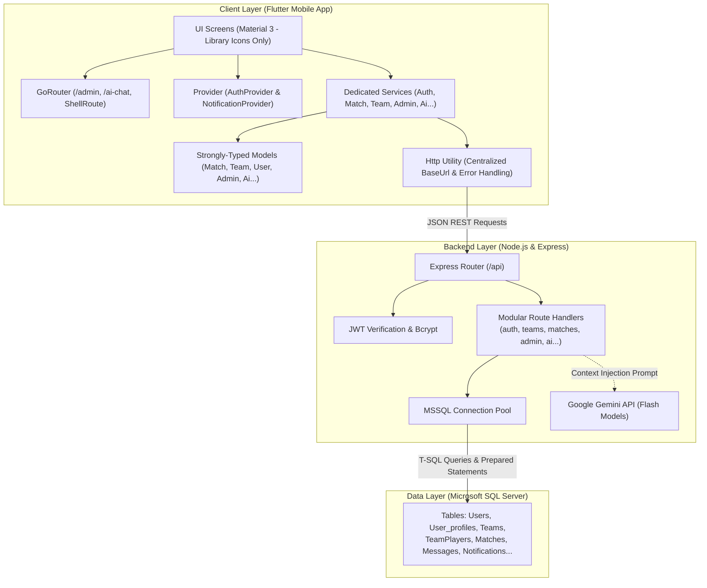

# KÈONHANH (KeoNhanh) - Nền Tảng Kết Nối & Ghép Kèo Sân Bóng Đá

<p align="center">
  
  
  
  
  
  
  
</p>

---

## 1. Giới Thiệu Dự Án

**Kèo Nhanh (KeoNhanh)** là ứng dụng di động hỗ trợ cộng đồng bóng đá phong trào giải quyết các khó khăn thường gặp:

- **Tìm đối giao lưu:** Dễ dàng tìm đội bạn cùng trình độ, cùng khu vực và khung giờ thi đấu phù hợp.
- **Tuyển quân & Tìm đội:** Cầu thủ tự do dễ dàng tìm kiếm câu lạc bộ; Đội trưởng tìm kiếm nhân tố bổ sung cho đội hình.
- **Ghim sân & Định vị:** Hỗ trợ tìm kiếm sân bóng qua bản đồ OpenStreetMap, định vị tọa độ GPS chính xác.
- **Giao tiếp nội bộ:** Kênh trò chuyện nhóm (Team Chat) riêng biệt cho từng đội bóng để thông báo và thảo luận chiến thuật.
- **Quản trị hệ thống (Admin Portal):** Phân hệ chuyên biệt dành cho Ban quản trị theo dõi chỉ số KPI, kiểm duyệt kèo đấu vi phạm, quản lý người dùng và phát thông báo toàn hệ thống.
- **Trợ lý AI thông minh (AI Match Assistant):** Tích hợp mô hình **Google Gemini Flash** hỗ trợ gợi ý kèo bóng đá dựa trên ngôn ngữ tự nhiên, áp dụng kỹ thuật **Context Injection (RAG)** chống ảo giác, hiển thị thẻ kèo tương tác trực tiếp trong luồng chat.
- **Cổng thanh toán PayOS (VietQR) & Đặc quyền thành viên:** Tích hợp thanh toán trực tuyến tự động qua **PayOS** với mô hình phân cấp tinh gọn: **Tài khoản Miễn phí** & **Gói Trả phí 1 tháng (29.000 VNĐ)**. Mở khóa tính năng ghim kèo nổi bật lên đầu trang và sử dụng Trợ lý AI Gemini không giới hạn.

---

## 2. Hướng Dẫn Cài Đặt & Khởi Chạy Ứng Dụng (Setup Guide)

### Yêu cầu môi trường tiên quyết:

- **Node.js** (v18 trở lên) & **npm**
- **Flutter SDK** (3.13 trở lên, hỗ trợ Dart 3)
- **Microsoft SQL Server** (2016 trở lên) đang chạy dịch vụ `MSSQLSERVER`

---

### Bước 1: Khởi tạo Cơ sở dữ liệu SQL Server

1. Mở **SQL Server Management Studio (SSMS)** hoặc **Azure Data Studio**.
2. Mở file [`keonhanh.sql`](file:///keonhanh.sql) trong thư mục gốc.
3. Bấm **Execute** (hoặc nhấn `F5`) để chạy toàn bộ script.
   > Script đã có sẵn cơ chế tạo database `Keonhanh`, toàn bộ các bảng dữ liệu và nạp sẵn dữ liệu mẫu thực tế.

---

### Bước 2: Cài đặt và Chạy Backend (Node.js Express)

1. Mở terminal, di chuyển vào thư mục backend:
   ```bash
   cd api
   ```
2. Cài đặt các gói thư viện:
   ```bash
   npm install
   ```
3. Tạo và chỉnh sửa file cấu hình môi trường `.env`:

   ```env
   PORT=3000
   DB_USER=sa
   DB_PASSWORD=YourPassword123
   DB_SERVER=localhost
   DB_NAME=Keonhanh
   JWT_SECRET=supersecretkey

   # Cấu hình Google Gemini AI
   GEMINI_API_KEY=your_gemini_api_key_here
   GEMINI_MODEL=gemini-3.5-flash-lite

   # Cấu hình Cổng thanh toán PayOS (VietQR)
   PAYOS_CLIENT_ID=your_client_id_here
   PAYOS_API_KEY=your_api_key_here
   PAYOS_CHECKSUM_KEY=your_checksum_key_here
   PAYOS_PACKAGE_PRICE=29000
   ```

   _(Lưu ý: Nếu chưa điền PayOS API Key, hệ thống tự động kích hoạt **Safe Mock VietQR Mode** kèm API giả lập `/api/payment/simulate-success/:orderCode` phục vụ kiểm thử và demo nhanh mà không cần tài khoản PayOS thật)_.

4. Khởi chạy máy chủ backend:
   ```bash
   npm run dev
   # Hoặc: npm start
   ```
   > Backend sẽ chạy tại địa chỉ: `http://localhost:3000`

---

### Bước 3: Cài đặt và Chạy Frontend (Flutter Mobile)

1. Cấu hình file `ui/.env`:
   - **Nếu chạy trên Trình duyệt Web (Chrome) hoặc Desktop (Windows):**
     ```env
     API_BASE_URL=http://localhost:3000
     ```
   - **Nếu chạy trên Máy ảo Android (Android Emulator):**
     ```env
     API_BASE_URL=http://10.0.2.2:3000
     ```
   - **Nếu chạy trên Thiết bị thật (Real Phone qua cùng Wi-Fi):**
     ```env
     API_BASE_URL=http://<IP-MÁY-TÍNH-CỦA-BẠN>:3000
     # Ví dụ: API_BASE_URL=http://192.168.1.15:3000
     ```
2. Mở terminal mới, di chuyển vào thư mục ứng dụng Flutter:
   ```bash
   cd ui
   ```
3. Tải các gói phụ thuộc Flutter:
   ```bash
   flutter pub get
   ```
4. Kiểm tra chất lượng mã nguồn:
   ```bash
   flutter analyze
   # Kết quả: No issues found!
   ```
5. Khởi chạy ứng dụng:
   ```bash
   flutter run
   ```

---

## 3. Danh Sách Tài Khoản Dùng Thử (Demo Accounts)

Tất cả các tài khoản mẫu dưới đây đã được nạp sẵn vào database với mật khẩu mặc định là: **`123456`**

| Tên đăng nhập        | Mật khẩu | Vai trò     | Mô tả tài khoản                       | Khu vực hoạt động                |
| :------------------- | :------- | :---------- | :------------------------------------ | :------------------------------- |
| **`admin_keonhanh`** | `123456` | **`admin`** | **Quản trị viên toàn quyền hệ thống** | TP. Hồ Chí Minh                  |
| `nguyen_van_a`       | `123456` | `captain`   | Đội trưởng FC Sài Gòn Phố             | Quận 1, TP. Hồ Chí Minh          |
| `tran_thi_b`         | `123456` | `captain`   | Đội trưởng FC Hà Nội Titans           | Quận Cầu Giấy, Hà Nội            |
| `le_van_c`           | `123456` | `captain`   | Đội trưởng FC Rồng Vàng Đà Nẵng       | Quận Hải Châu, Đà Nẵng           |
| `pham_hoang_d`       | `123456` | `captain`   | Đội trưởng FC Kèo Nhanh Allstars      | Quận Bình Thạnh, TP. Hồ Chí Minh |
| `dinh_trong_l`       | `123456` | `player`    | Cầu thủ tự do đang tìm đội            | Quận Phú Nhuận, TP. Hồ Chí Minh  |
| `duong_duc_m`        | `123456` | `player`    | Cầu thủ tự do đang tìm đội            | Quận Cầu Giấy, Hà Nội            |

---

## 4. Các Phân Hệ & Tính Năng Chính

### 4.1. Xác thực & Phân quyền (Authentication & Authorization)

- **Đăng ký tài khoản:** Kiểm tra trùng lặp tên người dùng, mật khẩu mã hóa an toàn bằng thuật toán **bcrypt** (salt 10).
- **Đăng nhập & Quản lý phiên:** Xác thực tài khoản, cấp **JWT Token** và lưu trữ thông tin phiên làm việc qua `AuthProvider`.
- **Phân quyền người dùng:** 3 cấp độ vai trò rõ ràng:
  - `player`: Cầu thủ thông thường.
  - `captain`: Đội trưởng có quyền tạo đội, quản lý thành viên, tạo kèo đấu.
  - `admin`: Quản trị viên toàn quyền hệ thống.
- **Bảo vệ tuyến đường (Route Guarding):** `GoRouter` tự động kiểm tra và chuyển hướng về màn hình đăng nhập hoặc từ chối truy cập trái phép vào các trang nội bộ (`/my-team`, `/matches`, `/profile`, `/admin`).

### 4.2. Hồ sơ cá nhân & Cầu thủ tự do (User Profiles)

- **Thiết lập hồ sơ:** Cập nhật ảnh đại diện (avatar URL), họ tên, số điện thoại, vị trí sở trường (_Thủ môn, Hậu vệ, Tiền vệ, Tiền đạo_), khu vực sinh sống.
- **Trạng thái tìm đội:** Bật/tắt trạng thái `isLookingForTeam` (Đang tìm đội / Đã có đội).
- **Khám phá cầu thủ:** Duyệt danh sách cầu thủ tự do, hỗ trợ tìm kiếm và lọc nhanh theo vị trí.

### 4.3. Quản lý Đội bóng (Team Management)

- **Tạo đội bóng mới:** Thiết lập tên đội, logo, cấp độ kỹ năng (_Sơ cấp, Trung cấp, Chuyên nghiệp_), khu vực hoạt động. Người tạo tự động trở thành **Đội trưởng (Captain)**.
- **Trạng thái tuyển quân:** Đội trưởng có thể bật/tắt trạng thái tuyển thành viên (`Searching` / `Full`).
- **Mời thành viên vào đội:** Đội trưởng duyệt danh sách cầu thủ và gửi lời mời gia nhập (`Invitations`).
- **Xin gia nhập đội:** Cầu thủ gửi đơn xin gia nhập (`JoinRequests`) đến các đội đang tuyển quân.
- **Duyệt thành viên:** Đội trưởng xem danh sách yêu cầu và phê duyệt (`Approve`) hoặc từ chối (`Reject`).
- **Quản trị thành viên:** Đội trưởng có quyền xóa thành viên (kick); thành viên có thể tự rời đội bóng (`Leave Team`).

### 4.4. Tạo & Ghép Kèo Đấu (Match Making)

- **Tạo kèo đấu:** Chọn đội thi đấu, ngày giờ, địa điểm và tên sân bóng.
- **Tích hợp bản đồ (OpenStreetMap):** Tìm kiếm sân bóng qua Nominatim API và tự động lưu tọa độ GPS (_Latitude, Longitude_).
- **Vòng đời kèo đấu:** Quản lý chặt chẽ 4 trạng thái:
  - `open`: Kèo đang chờ đối thủ nhận.
  - `matched`: Kèo đã có 2 đội chốt đối đầu.
  - `finished`: Kèo đã thi đấu hoàn tất.
  - `cancelled`: Kèo đã bị hủy.
- **Bắt kèo đối đầu:** Đội trưởng đội khác có thể bấm **"Bắt Kèo Ngay"** để ghép cặp thi đấu.
- **Hủy kèo / Rút kèo:** Đội tạo kèo có quyền hủy; đội nhận kèo có thể hủy ghép cặp nếu kế hoạch thay đổi.
- **Kèo của tôi:** Theo dõi toàn bộ lịch thi đấu của các đội bóng mà người dùng đang tham gia.

### 4.5. Trò chuyện nội bộ (Team Chat)

- **Phòng chat riêng:** Mỗi đội bóng sở hữu một phòng chat nội bộ riêng biệt.
- **Đồng bộ liên tục:** Ứng dụng tự động cập nhật tin nhắn mới định kỳ (Polling).
- **Trải nghiệm mượt mà:** Tự động cuộn xuống tin nhắn mới nhất, hiển thị tên, avatar và mốc thời gian rõ ràng.

### 4.6. Thông báo hệ thống (Notifications)

- Thông báo tự động khi có lời mời vào đội, duyệt đơn gia nhập, có đội nhận kèo đấu hoặc hủy ghép cặp.
- Thông báo broadcast từ Ban quản trị hệ thống gửi đến toàn thể người dùng.
- Nút chuông thông báo hiển thị số lượng tin chưa đọc kèm cơ chế đánh dấu đã đọc một chạm.

### 4.7. Phân hệ Quản trị viên (Admin Portal)

Màn hình chuyên biệt `/admin` (chỉ hiển thị cho tài khoản có vai trò `admin`):

- **Tab 1 - Tổng quan:** Bảng chỉ số KPI hệ thống (Tổng User, Tổng Đội, Tổng Kèo, Kèo Đang Mở, Kèo Đã Ghép) và danh sách trận đấu gần đây.
- **Tab 2 - Kiểm duyệt:** Xem toàn bộ kèo đấu và đội bóng trong hệ thống, hỗ trợ nút xóa cưỡng chế kèo hoặc giải tán đội bóng vi phạm quy định (kèm hộp thoại xác nhận an toàn).
- **Tab 3 - Quản lý Người dùng & Phân quyền:** Danh sách tài khoản kèm nhãn vai trò phân biệt màu sắc, ô tìm kiếm nhanh và menu chuyển đổi vai trò (`admin`, `captain`, `player`) ngay trên ứng dụng.
- **Tab 4 - Gửi Thông báo toàn hệ thống:** Soạn thảo tiêu đề + nội dung để phát thông báo đồng loạt đến hộp thư của tất cả người dùng trong hệ thống.

### 4.8. Trợ lý AI Gợi Ý Kèo Đấu (AI Match Assistant)

Màn hình trò chuyện `/ai-chat` kết nối với mô hình **Google Gemini Flash** (`gemini-3.5-flash-lite` / `gemini-1.5-flash`):

- **Gợi ý bằng ngôn ngữ tự nhiên:** Cầu thủ có thể hỏi bằng tiếng Việt tự nhiên (_"Tìm kèo tối nay ở Tân Bình", "Cuối tuần này ở Quận 7 có đội nào trình độ vừa phải không?"_).
- **Kỹ thuật RAG Context Injection:** AI nhận snapshot dữ liệu thực tế các kèo `open` trong SQL Server làm nguồn tri thức (grounding data), loại bỏ 100% tình trạng bịa đặt thông tin (hallucination).
- **Thẻ Kèo Tương Tác trong Chat (Rich UI):** Bên cạnh văn bản giải thích, AI nhúng các thẻ kèo đấu trực quan. Người dùng chỉ cần bấm vào thẻ để mở màn hình chi tiết và bắt kèo ngay.
- **Quick Prompts tiện lợi:** Hàng nút câu hỏi mẫu phía trên thanh nhập liệu (_Kèo bóng mở hôm nay_, _Kèo khu vực Tân Bình_, _Kèo khu vực Quận 7_, _Kèo cuối tuần này_).
- **Cơ chế Fallback thông minh (Safe Offline Matcher):** Nếu chưa cấu hình API Key hoặc mất kết nối internet, hệ thống tự động kích hoạt bộ xử lý từ khóa nội bộ để phân tích và trả về đúng các kèo phù hợp, đảm bảo an toàn tuyệt đối khi demo đồ án.

### 4.9. Cổng Thanh Toán PayOS (VietQR) & Đặc Quyền Thành Viên (29.000 VNĐ / Tháng)

Hệ thống phân cấp người dùng tinh gọn thành 2 cấp độ: **Miễn Phí (Free)** và **Trả Phí (Paid - 30 ngày)**:

- **Mức giá cố định minh bạch:** Hiển thị rõ ràng và thanh toán chính xác **29.000 VNĐ** cho 30 ngày sử dụng đặc quyền. Nếu người dùng gia hạn sớm, thời hạn 30 ngày được cộng dồn tiếp nối vào ngày hết hạn cũ.
- **Trang hiển thị VietQR độc lập (`/payment-qr`):** Giao diện chuyên biệt (không hiển thị trong modal/popup chật hẹp), hiển thị mã VietQR động chuẩn NAPAS 247, đồng hồ đếm ngược 15 phút, các nút sao chép thông tin chuyển khoản 1 chạm (Ngân hàng, Số tài khoản, Số tiền, Nội dung chuyển khoản).
- **Lưu ảnh mã QR về máy:** Tích hợp nút **"Lưu Ảnh QR Vào Máy"** (thông qua thư viện `gal`), tải trực tiếp mã thanh toán vào bộ sưu tập ảnh của điện thoại để người dùng dễ dàng mở ứng dụng Mobile Banking quét mã.
- **Tự động kích hoạt thông minh:** Backend xử lý **PayOS Webhook** tự động cập nhật trạng thái đơn hàng sang `PAID` và gia hạn người dùng. Đồng thời, màn hình thanh toán tự động kiểm tra trạng thái mỗi 3 giây (Smart Polling) để chuyển hướng về trang chủ ngay khi giao dịch thành công.
- **Các đặc quyền dành riêng cho Thành viên Trả phí:**
  1. **Ghim Kèo Lên Đầu Bảng Tin (Spotlight Match):** Đội trưởng có tài khoản trả phí có thể bật tùy chọn ghim khi tạo kèo. Kèo ghim luôn đứng vị trí đầu tiên trong danh sách, có viền vàng nổi bật và huy hiệu `NỔI BẬT`.
  2. **Trợ lý AI Gemini Không Giới Hạn:** Tài khoản miễn phí bị giới hạn 5 câu hỏi/ngày. Thành viên trả phí được hỏi đáp chiến thuật, tư vấn đối thủ và tìm kèo không giới hạn.
  3. **Huy hiệu Thành viên Đặc quyền:** Hiển thị trực tiếp trên thanh tiêu đề ứng dụng, màn hình Chat AI và trang Hồ sơ cá nhân.
- **Chế độ kiểm thử an toàn (Safe Mock & Simulation):** Đi kèm nút giả lập thanh toán thành công và API `/api/payment/simulate-success/:orderCode`, giúp giảng viên hoặc hội đồng nghiệm thu có thể kiểm thử toàn bộ luồng thanh toán và mở khóa tính năng ngay lập tức mà không cần chuyển khoản thật.

---

## 5. Kiến Trúc Hệ Thống (Architecture)



---

## 6. Công Nghệ Sử Dụng (Tech Stack)

### Frontend (Mobile App)

- **Framework:** [Flutter](https://flutter.dev/) (SDK ^3.13.2, Dart 3)
- **Quản lý trạng thái:** `provider: ^6.1.5`
- **Điều hướng:** `go_router: ^18.0.2` (Hỗ trợ ShellRoute, BottomTabs, Route Guards)
- **Môi trường & Cấu hình:** `flutter_dotenv: ^6.0.0`
- **Giao tiếp mạng:** `http: ^1.6.0`
- **Bản đồ & Tọa độ:** OpenStreetMap Nominatim API, `url_launcher: ^6.3.3`
- **Xử lý ảnh & Thư viện phương tiện:** `image_picker: ^1.2.3`, `gal: ^2.3.3` (Lưu ảnh VietQR vào thư viện thiết bị)
- **Thiết kế giao diện:** Material 3, sử dụng 100% icon từ thư viện Flutter (`Icons.*`), loại bỏ hoàn toàn emoji, giao diện đồng nhất chuẩn màu `#16A34A`.

### Backend (RESTful API)

- **Nền tảng:** [Node.js](https://nodejs.org/) (v18+)
- **Web Framework:** [Express.js](https://expressjs.com/) v5.x
- **Cổng thanh toán trực tuyến:** `@payos/node` (v2.x) - Thanh toán tự động VietQR chuẩn NAPAS 247
- **Trí tuệ nhân tạo:** **Google Gemini API** (`gemini-3.5-flash-lite`, `gemini-1.5-flash`) tích hợp qua native `fetch` và RAG context injection.
- **Bảo mật:** `jsonwebtoken` (JWT), `bcrypt` (password hashing)
- **Driver CSDL:** `mssql: ^12.7.3`
- **Môi trường & Tiện ích:** `dotenv`, `cors`

### Database (Cơ sở dữ liệu)

- **Hệ quản trị CSDL:** Microsoft SQL Server 2016+
- **Chuẩn định dạng ID:** `UNIQUEIDENTIFIER` (UUID/GUID - `NEWID()`)
- **Toàn vẹn dữ liệu:** Ràng buộc `CHECK`, Khóa ngoại `FOREIGN KEY`, `CASCADE/RESTRICT`

---

## 7. Cấu Trúc Thư Mục Chuẩn Hóa (Project Structure)

Codebase được tái cấu trúc hoàn toàn theo kiến trúc phân tầng chuẩn (Layered Architecture):

```text
keonhanh/
├── keonhanh.sql                # Script khởi tạo Database, Tables và Seed data mẫu
├── README.md                          # Tài liệu hướng dẫn toàn diện của dự án
│
├── api/                               # Source code Node.js REST API (Backend)
│   ├── config/
│   │   ├── database.js                # Cấu hình và kết nối MSSQL Server Pool
│   │   └── payos.js                   # Cấu hình PayOS SDK & Fallback Safe Mock VietQR
│   ├── routes/
│   │   ├── api.js                     # Router tổng hợp các phân hệ API
│   │   ├── auth.js                    # Đăng ký & Đăng nhập (/api/auth)
│   │   ├── profiles.js                # Hồ sơ cá nhân (/api/user-profiles)
│   │   ├── players.js                 # Danh sách cầu thủ tìm đội (/api/players)
│   │   ├── teams.js                   # Quản lý đội bóng (/api/teams)
│   │   ├── matches.js                 # Quản lý kèo đấu (/api/matches)
│   │   ├── join-requests.js           # Yêu cầu xin vào đội (/api/join-requests)
│   │   ├── invitations.js             # Lời mời tham gia đội (/api/invitations)
│   │   ├── messages.js                # Tin nhắn đội (/api/messages)
│   │   ├── notifications.js           # Thông báo hệ thống (/api/notifications)
│   │   ├── admin.js                   # Quản trị hệ thống (/api/admin)
│   │   ├── ai.js                      # Trợ lý AI Gemini gợi ý kèo (/api/ai)
│   │   └── payment.js                 # Cổng thanh toán PayOS & Gia hạn (/api/payment)
│   ├── .env                           # Biến môi trường thực tế (SQL, JWT, Gemini Key)
│   ├── .env.example                   # File mẫu biến môi trường
│   ├── index.js                       # Điểm khởi chạy Express server
│   └── package.json
│
└── ui/                                # Source code ứng dụng Flutter Mobile (Frontend)
    ├── .env                           # Cấu hình IP và BASE_URL ứng dụng
    ├── .env.example                   # File mẫu cấu hình Flutter
    ├── lib/
    │   ├── config/
    │   │   └── config.dart            # Nạp và cung cấp cấu hình môi trường AppConfig
    │   ├── models/                    # Data models định kiểu chặt chẽ
    │   │   ├── admin_models.dart      # Model thống kê và quản lý user Admin
    │   │   ├── ai_chat_model.dart     # Model tin nhắn hội thoại và phản hồi AI
    │   │   ├── chat_message_model.dart# Model tin nhắn nội bộ đội
    │   │   ├── invitation_model.dart  # Model lời mời gia nhập đội
    │   │   ├── join_request_model.dart# Model đơn xin vào đội
    │   │   ├── match_model.dart       # Model trận đấu bóng đá
    │   │   ├── notification_model.dart# Model thông báo
    │   │   ├── player_model.dart      # Model cầu thủ tự do
    │   │   ├── team_model.dart        # Model đội bóng
    │   │   ├── user_model.dart        # Model thông tin tài khoản người dùng
    │   │   └── models.dart            # Export barrel file
    │   ├── providers/                 # Quản lý State toàn cục bằng Provider
    │   │   ├── auth_provider.dart     # Trạng thái đăng nhập, userId, username, role, isAdmin
    │   │   └── notification_provider.dart # Trạng thái thông báo và polling chuông
    │   ├── services/                  # Tầng kết nối mạng và tương tác API
    │   │   ├── admin_service.dart     # Gọi API phân hệ Admin
    │   │   ├── ai_service.dart        # Gọi API Trợ lý AI Gemini
    │   │   ├── auth_service.dart      # Gọi API xác thực
    │   │   ├── chat_service.dart      # Gọi API chat nhóm
    │   │   ├── invitation_service.dart# Gọi API lời mời gia nhập
    │   │   ├── join_request_service.dart # Gọi API duyệt yêu cầu vào đội
    │   │   ├── match_service.dart     # Gọi API kèo đấu
    │   │   ├── notification_service.dart # Gọi API thông báo
    │   │   ├── payment_service.dart   # Gọi API Cổng thanh toán PayOS & Đăng ký gói
    │   │   ├── player_service.dart    # Gọi API danh sách cầu thủ
    │   │   ├── profile_service.dart   # Gọi API hồ sơ cá nhân
    │   │   ├── team_service.dart      # Gọi API đội bóng
    │   │   └── services.dart          # Export barrel file
    │   ├── utils/
    │   │   ├── http.dart              # HTTP Client chuẩn hóa URL, header, timeout
    │   │   └── utils.dart             # Export barrel file
    │   ├── widgets/                   # Các UI Widget tái sử dụng
    │   │   ├── empty_state.dart       # Giao diện hiển thị danh sách rỗng
    │   │   ├── loading_view.dart      # Giao diện xoay vòng chờ tải
    │   │   ├── match_card.dart        # Thẻ thông tin kèo đấu chuẩn (Hỗ trợ huy hiệu Nổi Bật)
    │   │   ├── notification_button.dart # Nút chuông thông báo kèm badge số
    │   │   ├── status_badge.dart      # Nhãn trạng thái màu sắc
    │   │   └── widgets.dart           # Export barrel file
    │   ├── screens/                   # Màn hình giao diện người dùng
    │   │   ├── admin/
    │   │   │   └── admin_dashboard_screen.dart # Bảng điều khiển Quản trị viên (4 Tab)
    │   │   ├── ai/
    │   │   │   └── ai_chat_screen.dart# Màn hình Trợ lý AI gợi ý kèo đấu
    │   │   ├── auth/
    │   │   │   ├── login_screen.dart  # Màn hình đăng nhập
    │   │   │   └── register_screen.dart # Màn hình đăng ký
    │   │   ├── home/
    │   │   │   ├── home_screen.dart   # Trang chủ (Banner, Kèo nổi bật, Phím tắt, Nút AI, Badge gói)
    │   │   │   ├── match_screen.dart  # Quản lý kèo đấu của tôi (Kèm nút FAB Hỏi AI)
    │   │   │   ├── my_team_screen.dart# Quản lý đội bóng của tôi & duyệt thành viên
    │   │   │   ├── player_list_screen.dart # Danh sách cầu thủ tự do
    │   │   │   ├── all_matches_screen.dart # Xem toàn bộ kèo đấu hệ thống
    │   │   │   ├── create_match_screen.dart# Tạo kèo đấu kèm bản đồ định vị & Ghim Spotlight
    │   │   │   ├── match_detail_screen.dart# Chi tiết trận đấu và nút bắt kèo
    │   │   │   ├── create_team_screen.dart # Tạo đội bóng mới
    │   │   │   ├── find_team_screen.dart   # Tìm kiếm đội bóng và xin gia nhập
    │   │   │   └── team_chat_screen.dart   # Phòng chat nội bộ đội bóng
    │   │   └── profile/
    │   │       ├── profile_setup_screen.dart # Hồ sơ cầu thủ, Trạng thái gói & Lối vào Quản trị
    │   │       ├── upgrade_screen.dart       # Trang giới thiệu gói nâng cấp 29.000đ
    │   │       └── payment_qr_screen.dart    # Trang hiển thị mã VietQR độc lập & Lưu ảnh QR
    │   └── main.dart                  # Cấu hình GoRouter, BottomNavigationBar và khởi chạy
    └── pubspec.yaml
```

---

## 8. Thiết Kế Cơ Sở Dữ Liệu (Database Schema)

Hệ thống bao gồm **11 bảng dữ liệu** quan hệ trong cơ sở dữ liệu `Keonhanh`:

| Bảng                | Chức năng                                                                 | Khóa chính | Khóa ngoại chính                                                                      |
| :------------------ | :------------------------------------------------------------------------ | :--------- | :------------------------------------------------------------------------------------ |
| **`Users`**         | Tài khoản đăng nhập, mật khẩu băm, vai trò, trạng thái trả phí (`IsPaid`, `PaidUntil`) | `Id`       | Không có                                                                              |
| **`User_profiles`** | Hồ sơ cầu thủ, vị trí, khu vực, trạng thái tìm đội                        | `Id`       | `UserId` $\rightarrow$ `Users(Id)`                                                    |
| **`Teams`**         | Thông tin đội bóng, logo, cấp độ, trạng thái tuyển quân                   | `Id`       | `CaptainId` $\rightarrow$ `Users(Id)`                                                 |
| **`TeamPlayers`**   | Bảng liên kết nhiều-nhiều giữa Đội bóng và Cầu thủ                        | `Id`       | `TeamId` $\rightarrow$ `Teams(Id)`, `UserProfileId` $\rightarrow$ `User_profiles(Id)` |
| **`Matches`**       | Kèo đấu, thời gian, tên sân, địa chỉ, GPS, trạng thái, cờ ghim (`IsPinned`)| `Id`       | `CreatorTeamId`, `MatchedWithTeamId` $\rightarrow$ `Teams(Id)`                        |
| **`JoinRequests`**  | Đơn xin gia nhập đội của cầu thủ tự do                                    | `Id`       | `RequesterId` $\rightarrow$ `User_profiles(Id)`, `TeamId` $\rightarrow$ `Teams(Id)`   |
| **`Invitations`**   | Lời mời cầu thủ gia nhập đội từ đội trưởng                                | `Id`       | `TeamId` $\rightarrow$ `Teams(Id)`, `UserId` $\rightarrow$ `Users(Id)`                |
| **`Messages`**      | Tin nhắn thảo luận nội bộ đội bóng                                        | `Id`       | `TeamId` $\rightarrow$ `Teams(Id)`, `SenderId` $\rightarrow$ `Users(Id)`              |
| **`Notifications`** | Thông báo ghép kèo, lời mời, yêu cầu gia nhập, broadcast                  | `Id`       | `UserId` $\rightarrow$ `Users(Id)`                                                    |
| **`Payments`**      | Lịch sử giao dịch VietQR PayOS (`OrderCode`, `Amount`, `Status`, `PaidAt`)| `Id`       | `UserId` $\rightarrow$ `Users(Id)`                                                    |
| **`AiDailyUsage`**  | Đếm số câu hỏi Gemini AI theo ngày của người dùng (`UsageDate`, `QuestionCount`) | `Id` | `UserId` $\rightarrow$ `Users(Id)`                                                    |

---

## 9. Danh Sách API Endpoints (API Reference)

### 🔑 Authentication

- `POST /api/auth/register` : Đăng ký tài khoản mới
- `POST /api/auth/login` : Đăng nhập, nhận JWT Token và thông tin vai trò (`role`)

### 👤 User Profiles & Players

- `GET /api/user-profiles/:userId` : Lấy hồ sơ cầu thủ theo ID tài khoản
- `POST /api/user-profiles` : Tạo hoặc cập nhật thông tin hồ sơ
- `GET /api/players` : Lấy danh sách toàn bộ cầu thủ đang tìm đội

### 🛡️ Teams

- `GET /api/teams` : Danh sách tất cả đội bóng
- `GET /api/teams/:id` : Chi tiết đội bóng & danh sách thành viên
- `GET /api/teams/my-team/:profileId` : Danh sách các đội người dùng tham gia
- `POST /api/teams` : Tạo đội bóng mới
- `POST /api/teams/:teamId/remove-member` : Đội trưởng kích thành viên
- `POST /api/teams/:teamId/leave-team` : Thành viên tự rời đội
- `PATCH /api/teams/:teamId/recruiting` : Bật/tắt trạng thái tuyển quân

### ⚽ Matches

- `GET /api/matches` : Danh sách tất cả các kèo đấu
- `GET /api/matches/:id` : Chi tiết một kèo đấu
- `GET /api/matches/team/:teamId` : Danh sách kèo của một đội
- `POST /api/matches` : Tạo kèo đấu mới
- `POST /api/matches/:id/match` : Nhận kèo (Ghép cặp 2 đội)
- `POST /api/matches/:id/unmatch` : Hủy nhận kèo (Mở lại kèo)
- `DELETE /api/matches/:id` : Xóa/Hủy kèo đấu

### 📨 Join Requests & Invitations

- `GET /api/join-requests/captain/:userId` : Danh sách yêu cầu xin vào đội gửi tới đội trưởng
- `GET /api/join-requests/player/:profileId`: Danh sách yêu cầu đã gửi của cầu thủ
- `POST /api/join-requests` : Cầu thủ gửi đơn xin gia nhập đội
- `PATCH /api/join-requests/:id/approve` : Đội trưởng duyệt đơn xin vào đội
- `PATCH /api/join-requests/:id/reject` : Đội trưởng từ chối đơn
- `GET /api/invitations/user/:userId` : Lời mời tham gia đội gửi đến người dùng
- `POST /api/invitations` : Đội trưởng gửi lời mời gia nhập đội cho cầu thủ
- `PATCH /api/invitations/:id/accept` : Chấp nhận lời mời gia nhập
- `PATCH /api/invitations/:id/reject` : Từ chối lời mời gia nhập

### 💬 Team Messages

- `GET /api/messages/:teamId` : Lấy lịch sử tin nhắn phòng chat đội
- `POST /api/messages` : Gửi tin nhắn mới vào phòng chat đội

### 🔔 Notifications

- `GET /api/notifications` : Lấy danh sách thông báo theo `userId` (hỗ trợ polling 5s)
- `PATCH /api/notifications/:id/read` : Đánh dấu một thông báo là đã đọc
- `PATCH /api/notifications/read-all/:userId` : Đánh dấu tất cả thông báo là đã đọc
- `POST /api/notifications` : Tạo thông báo mới
- `DELETE /api/notifications/:id` : Xóa thông báo

### 👑 Admin Management (`/api/admin`)

- `GET /api/admin/stats` : Lấy các chỉ số KPI thống kê tổng quan toàn hệ thống
- `GET /api/admin/users` : Danh sách tất cả tài khoản kèm thông tin hồ sơ và vai trò
- `PATCH /api/admin/users/:id/role` : Cập nhật vai trò người dùng (`admin`, `captain`, `player`)
- `POST /api/admin/broadcast` : Gửi thông báo hệ thống đồng loạt đến tất cả người dùng
- `DELETE /api/admin/matches/:id` : Xóa hoặc hủy cưỡng chế trận đấu vi phạm quy định
- `DELETE /api/admin/teams/:id` : Giải tán đội bóng vi phạm (tự động dọn dẹp các ràng buộc phụ thuộc)

### 🤖 AI Assistant (`/api/ai`)

- `POST /api/ai/chat` : Gửi câu hỏi tìm kiếm kèo đấu bằng ngôn ngữ tự nhiên. Trả về câu trả lời tư vấn kèm danh sách các đối tượng `MatchModel` phù hợp được trích xuất từ database SQL Server (Tài khoản miễn phí tối đa 5 câu/ngày; Thành viên trả phí không giới hạn).
- `GET /api/ai/usage/:userId` : Lấy số lượng câu hỏi AI đã dùng trong ngày và hạn mức còn lại.

### 💳 PayOS Payment & Subscriptions (`/api/payment`)

- `POST /api/payment/create-payment-link` : Khởi tạo giao dịch thanh toán VietQR PayOS (29.000 VNĐ cho gói 30 ngày)
- `POST /api/payment/payos-webhook` : Endpoint nhận Webhook tự động từ PayOS xác nhận chuyển khoản thành công và gia hạn tài khoản
- `GET /api/payment/check-status/:orderCode` : Kiểm tra trạng thái thanh toán của mã đơn hàng (Smart Polling 3s)
- `GET /api/payment/subscription/:userId` : Lấy thông tin trạng thái gói đặc quyền và số ngày sử dụng còn lại
- `POST /api/payment/simulate-success/:orderCode` : Giả lập thanh toán thành công tức thì (Dành cho việc kiểm thử / chấm điểm đồ án)

---

## 10. Tiêu Chuẩn Giao Diện & Mã Nguồn

- **Chuẩn UI nhất quán:** Màu xanh lá chủ đạo `#16A34A`, nền xám sáng sạch sẽ `#F8FAFC`, phân cấp thông tin rõ ràng, loại bỏ hoàn toàn các thông tin thừa thãi.
- **100% Icon từ Thư viện Flutter (`Icons.*`):** Tuyệt đối không dùng emoji trong văn bản, tiêu đề hay nhãn nút bấm, mang lại giao diện ứng dụng chuyên nghiệp.
- **Code Quality:** Kiểm tra qua `flutter analyze` đạt **0 issues found** (0 lỗi, 0 cảnh báo).

---

## 📄 Bản Quyền (License)

Dự án được xây dựng phục vụ môn học PRM393 và nghiên cứu học tập. Giữ toàn quyền tác giả.
